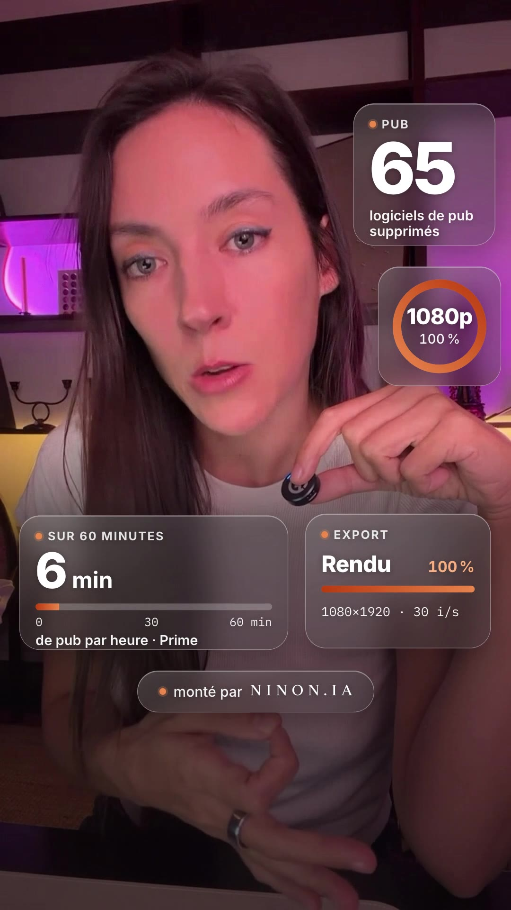
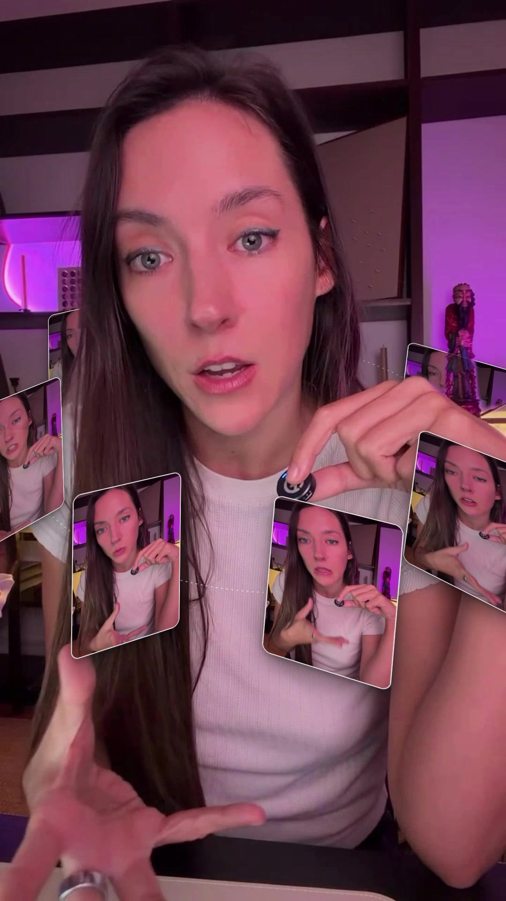
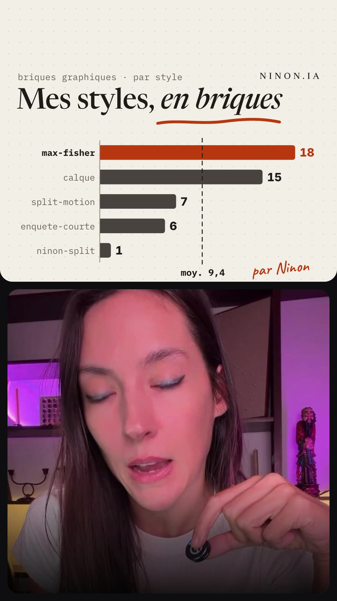
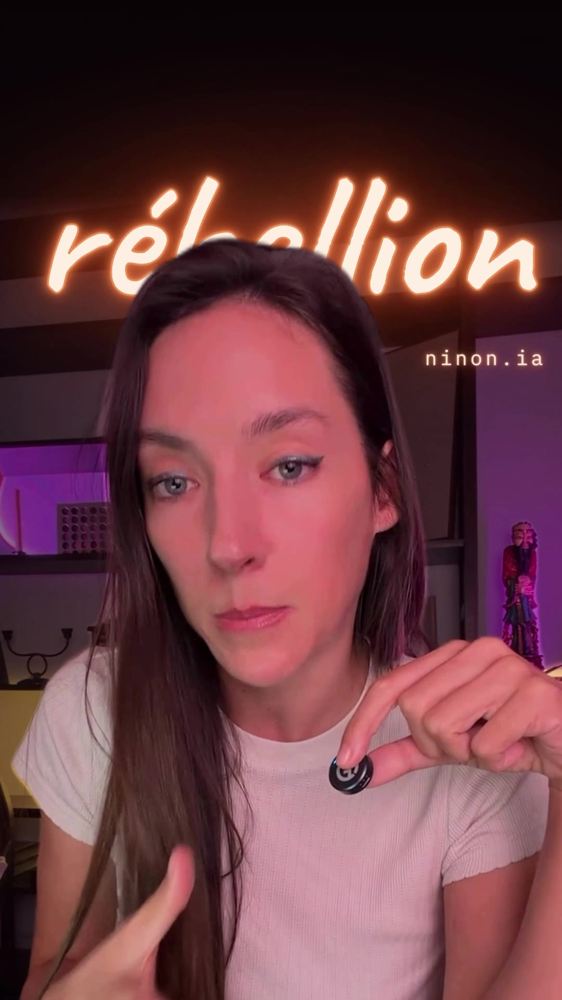
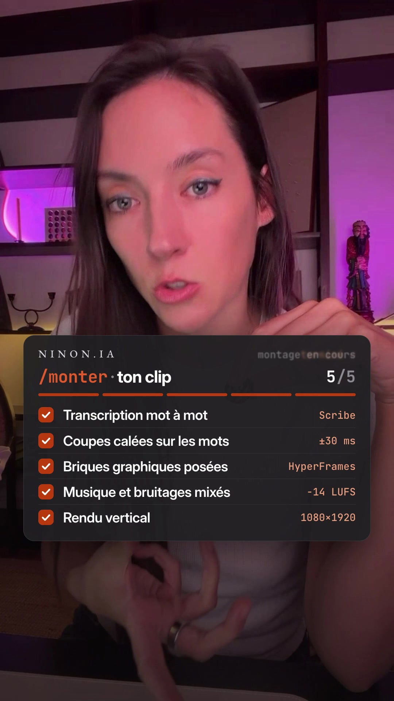
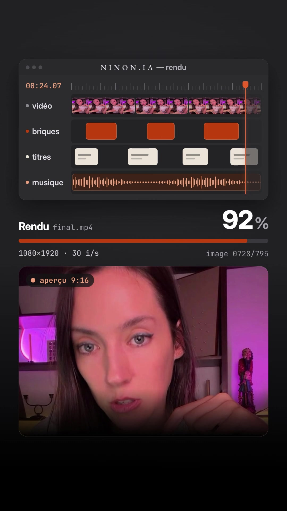

# ninon-effets : 7 effets vidéo pour Claude Code

7 effets visuels pour tes Reels, TikTok et Shorts. Tu les appliques à n'importe quel clip avec une commande dans
Claude Code : pas de logiciel de montage, pas de timeline. Par **Ninon** (ninon.ia).

| | Effet | Ce que ça fait |
|---|---|---|
|  | **verre** | des widgets en verre dépoli autour de ton visage |
|  | **documentaire** | toi détouré·e en noir et blanc, façon affiche documentaire |
|  | **orbite** | des cartes qui tournent autour de toi, devant et derrière |
|  | **graphique** | un graphique en barres animé au-dessus de toi |
|  | **neon** | un mot en néon derrière ta tête |
|  | **checklist** | des étapes qui se cochent |
|  | **rendu** | une fenêtre de rendu qui monte jusqu'à 100 % |

Chaque effet dure de 2 à 8 s, en 1080×1920, et tous les textes se changent.

## Installer

1. Il te faut [Claude Code](https://claude.com/claude-code), `ffmpeg` et Node.js 18 ou plus. Sur Mac : `brew install ffmpeg node`.
2. Copie le skill dans ton dossier de skills :

```bash
git clone https://github.com/<ton-compte>/ninon-effets ~/.claude/skills/effets
```

## Utiliser

Dans Claude Code, donne ton clip et tape :

```
/effets neon
```

Claude te demande le moment du clip et tes textes, rend l'effet, vérifie l'image et te donne le fichier.

Tu peux aussi lancer le script toi-même :

```bash
bash ~/.claude/skills/effets/rendre-effet.sh neon mon-clip.mp4 --debut 12.4
```

Les options et les textes de chaque effet sont dans `SKILL.md` et dans `effets/<nom>/effet.json`.

## Comment ça marche

- Chaque effet est une composition [HyperFrames](https://github.com/heygen-com/hyperframes) (HTML et GSAP rendus en vidéo).
- Le script recadre ton clip et te détoure en local (`hyperframes remove-background`).
- Il rend l'effet sans son, prêt à poser dans ton montage.
- Pour créer ton propre effet, suis `effets/CONTRAT.md`.

## Licences

- **Code et compositions** : licence MIT (`LICENSE`).
- **Polices** : SIL Open Font License 1.1 (Inter, Newsreader, Caveat, IBM Plex Mono). Le détail est dans `effets/<nom>/assets/fonts/LICENCES.md`.
- **Images d'aperçu** : elles montrent Ninon et ne sont là que pour la démonstration. Ne les réutilise pas ailleurs.
